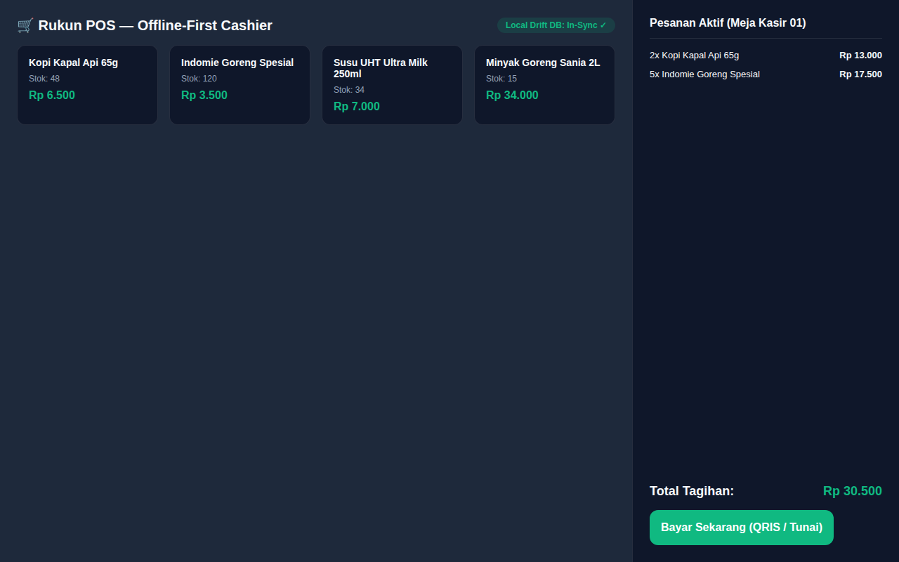
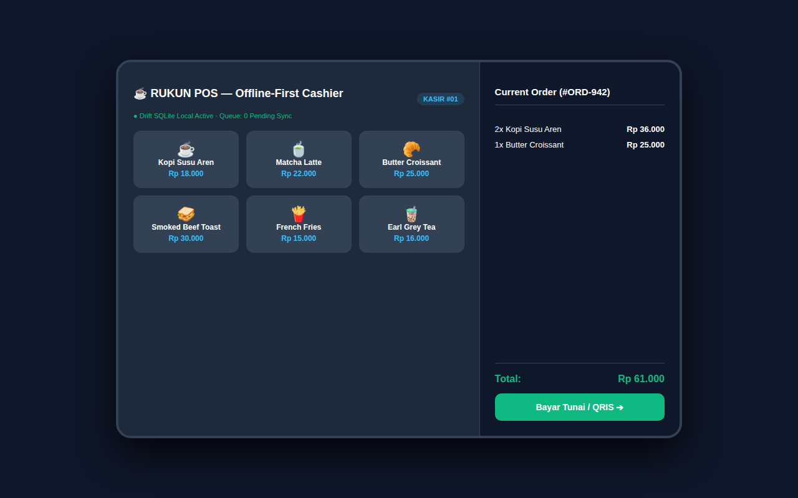

# 🏪 Rukun — Offline-First Retail POS & Real-Time Live Owner Console

> **Resilient offline-first Point-of-Sale mobile app powered by Flutter, Drift SQLite, and Go Fiber backend with Server-Sent Events (SSE).**

---

## 📸 Visual Showcase & Dual-Surface Operations

  

<em>Figure 1: Web Owner Live Console streaming real-time cashier transactions, daily gross revenue, and low-stock alerts.</em>

 

  <table width="100%">
    <tr>
      <td width="100%" align="center">
        
         <strong>Figure 2: Flutter Tablet Cashier Register (Offline-First)</strong> 
        <em>Instant local checkout backed by Drift SQLite with optimistic queue synchronization on internet reconnection.</em>
      </td>
    </tr>
  </table>

---

## 🔌 Offline-First Resiliency

- **Zero Network Blocker:** Kasir can process unlimited sales even when the internet is completely severed. Orders write immediately to local Drift SQLite.
- **Automatic Sync Queue:** Background worker replays queued orders to the Go backend via idempotent UUIDs upon network restoration.
- **Live SSE Stream:** Store owner dashboard updates in real-time via Server-Sent Events without polling.
